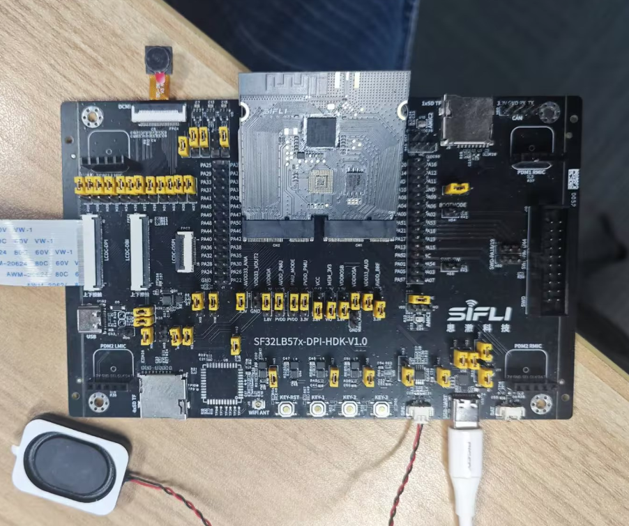
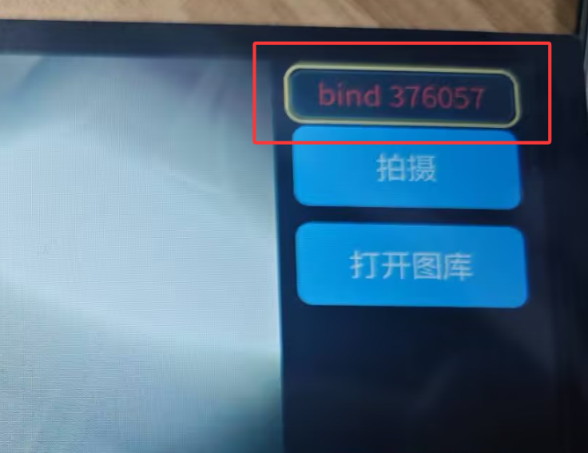

# 拍学机（SF32LB57x + OV2640 + 小智 XiaoZhi）

本项目面向搭载 SF32LB57EYBBN6 的相机硬件，使用 OV2640 8-bit DVP 并行摄像头、1024×600 DPI 屏幕、三个 ADC 按键和外接 16 MiB PY25Q128HA NOR。

除了原有的实时预览、拍照保存与本地图库，工程在顶层实现了完整的“拍学机”体验：**拍一张照片 → 按住按键提问 → 松手把“这张照片 + 这句话”一起发给小智 → 屏幕显示回答状态并从扬声器念出来**。相机框架与 SDK 不参与这部分改动，新增能力都在 `src/` 的顶层模块里。

构建使用兼容板型 `dpi-hdk_lb57eybbn6_n16_qspi`，屏幕型号为 `HTM_H070A20_RGB_A01`。工程按 NOR 前 8 MiB 配置容量和分区。

## 快速上手

### 1. 硬件环境


### 2. 软件环境

- 安装 [SiFli SDK](https://github.com/OpenSiFli/SiFli-SDK-Peripherals) 与 SDK（本项目基于 SDK main），并设置环境变量 `SIFLI_SDK_TOOLS_PATH`。
- 准备外置外设库，并把路径写进 `SIFLI_PERIPHERALS_ROOT`：工程通过它引用 `SiFli-SDK-Peripherals/camera_framework` 的 Kconfig 和 SCons 入口。
```powershell
$env:SIFLI_PERIPHERALS_ROOT = '{YOUR_PERIPHERALS_PATH}/SiFli-SDK-Peripherals' 
```

### 3. 编译

在 PowerShell 中执行（路径换成自己机器上的）：

```powershell
$env:SIFLI_SDK_TOOLS_PATH = "d:\SiFli\Toolain"
. <SDK 目录>\export.ps1
$env:SIFLI_PERIPHERALS_ROOT = '<SiFli-SDK-Peripherals 目录>'
Set-Location <本工程>\project
scons --board=dpi-hdk_lb57eybbn6_n16_qspi -j8
```

判断成功的标志是最后一行 `scons: done building targets.`。构建输出很长，建议重定向到文件后再检视；`project/build_<board>/main.map` 可以看到每个源文件是否真的进了镜像。

### 4. 烧录

```powershell
Set-Location <本工程>\project\build_dpi-hdk_lb575ybbn6_n16_qspi_hcpu
.\download.bat
```
### 5. 上手体验
1. **首次开机并建立bt pan连接时**需要绑定设备才可以访问设备，我们需要登录[xiaozhi](https://xiaozhi.me/console/agents)，然后点击添加设备，输入下图中显示的6位验证码:

2. 开机后左侧是 800×600 实时预览，右侧是操作栏，默认焦点在“拍摄”。
3. 短按键 3 拍照 → 预览区显示“拍摄中.../保存中.../加载中...” → 状态显示“已保存”，侧栏出现**黄框的“待提问照片”**。
4. **按住键 3 不放**（约 0.3 秒）→ 语音条显示 `listening`，对着麦克风提问（如“这是什么？”）→ **松手** → 语音条显示 `sent`，照片和这句话一起发给小智。
5. 小智回答时语音条显示 `answering`，答案文本上屏并**从扬声器念出**。
6. 看图：焦点移到“打开图库”→ 键 3 进入 → 键 1/键 2 移动焦点 → 键 3 看大图；大图里键 1/键 2 翻页，键 3 返回。
7. 删图：图库页焦点移到 `delete` → 键 3 → 按钮变红、提示 `tap a photo` → 选中缩略图即删除；再按一次 `delete` 或长按键 3 退出。

## 相关问题
1. 照片什么时候会发出去？发的是哪一张？

不用手动“上传”。照片是**小智主动来要**的：你说完话松手后，如果小智觉得需要看图（比如你问“这是什么”“帮我看看图片里的东西”），它才会向设备要一张照片，设备这时才把照片发过去，然后说出答案。它不要，就不会发。因此你要表明自己需要图片的意思

设备挑照片的顺序是固定的：

- **优先用黄框那张**：也就是你最近一次短按键 3 拍到、而且还没删掉的那张（就是侧栏里黄框的小图）。
- **没有黄框照片时，用相册里最新的一张**：比如刚开机、还没拍过照就直接提问。

想让它看你想给它看的东西：

- **先拍，再问**：短按键 3 拍一张（看到黄框出现），再按住键 3 提问。不先拍的话，它看到的可能是相册里的旧照片，回答也就对不上眼前的东西。
- **黄框那张一直有效，直到你把它删掉**：连着问好几次、中间不重新拍照的话，小智每次看到的都是同一张照片；想换内容，就再拍一张。
- **照片只在它来要的时候才发**：设备不会自己把相册里的照片发出去。

2. 为何已就绪状态下会时常跳转到未就绪状态？
长时间不使用xiaozhi，xiaozhi服务器会主动断连，但是我在本地加了自动回连的机制，可以手动选中 xiaozhi控件 将其设置为未就绪态，这样就不会触发自动回连。

3. xiaozhi一直显示未就绪怎么办？
先用手机连接，手机显示已连接，再复位板子，板子会自动连接。

4. 为何反复报 `mbedtls_ssl_setup error, return -0x7f00` 并一直重连？
`-0x7f00` 是 mbedtls 的 `MBEDTLS_ERR_SSL_ALLOC_FAILED`：HTTPS 握手要一次性分配到两个约 16.7 KB 的收发缓冲，而 HCPU 的 `rt_malloc` 堆已被占满。
本板 512 KB HPSYS RAM 原先在 `project/dpi-hdk_lb57eybbn6_n16_qspi_hcpu/ptab.json` 里被切成 HCPU `0x6FC00` + ACPU `0xFC00`，而本工程 `CONFIG_BSP_USING_ACPU` 未开启、不跑 ACPU 镜像，那 63 KB 是白留的；现已把 ACPU 段并给 HCPU（`HCPU_RAM_DATA` = `0x7F700`，即 512K − 2K mailbox − 256B custom config），可分配堆由约 260 KB 增至约 325 KB。
验证：开机 `list_mem` 的 `total memory` 应为 ~324,8xx。若仍是 ~260 KB，说明 `ptab.h` 没重新生成，删掉 `project/build_<board>/ptab.h` 后再编译一次。
