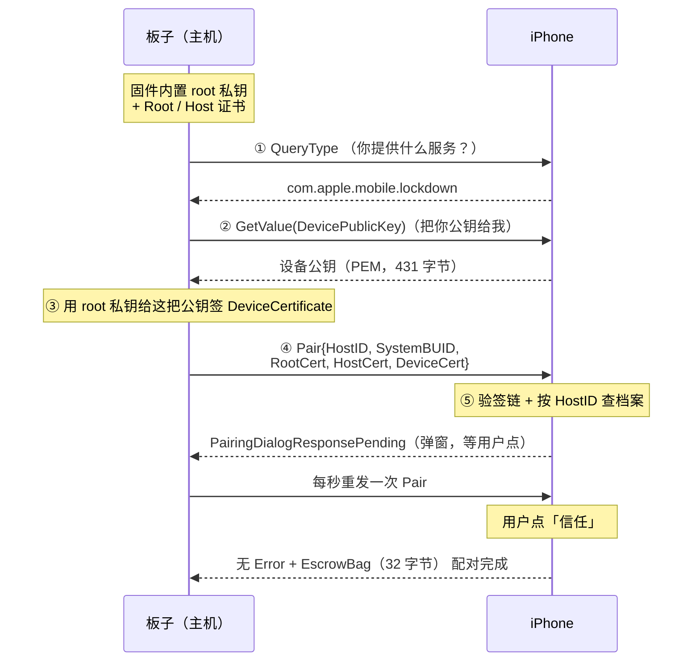

# pairing — iPhone lockdown Pair 模块

一个自包含的模块：通过 USB 与 iPhone 完成一次 **lockdown Pair**（配对）握手。配对完成后手机会立即开始向主机推送 ipheth（USB 网络共享）数据帧，链路随即建立。


---

## 它解决什么问题

- 插上线后必须手动关开一次个人热点；
- "要信任此电脑吗"弹窗要 20~35 秒才出现。

主机完成一次 Pair 后，两个症状一起消失。PC 上是 iTunes/AMDS 在做这件事，本模块在板子上做同样的事。

---

## 配对流程

### 时序



### 每一步做什么

| 步骤 | 报文 / 动作 | 说明 | 代码 |
|---|---|---|---|
| ① | `Request = QueryType` | 确认对端是 `com.apple.mobile.lockdown` 服务 | `iph_pair.c` `pair_try_once()` |
| ② | `Request = GetValue`，`Key = DevicePublicKey` | 向手机索要它的公钥 | 同上 |
| ③ | 板子内部签证书 | 用内置 root 私钥给上一步拿到的公钥签 `DeviceCertificate` | `iph_devcert.c` `iph_devcert_build()` |
| ④ | `Request = Pair` | 三张证书 + `HostID` + `SystemBUID` 一起发过去 | `iph_pair.c` `pair_build_xml()` |
| ⑤ | 等用户确认 | 手机回 `PairingDialogResponsePending` 期间每秒重发一次，最多 60 秒 | 同上 |

### 三张证书的来源不同

只有一张是现场生成的：

| 证书 | 来源 | 内容 |
|---|---|---|
| `RootCertificate` | 固件内置（`gen_pair_identity.py` 预生成） | root 自签证书，CA:TRUE |
| `HostCertificate` | 固件内置 | root 签发的 host 证书，CA:FALSE |
| `DeviceCertificate` | **连接时现场签发** | subject 是手机公钥，issuer 是 root |

### Pair 报文的实际结构

```
Request = "Pair"
PairRecord = {
    HostID            = "5AF01A2B-..."
    SystemBUID        = "A1B2C3D4-..."
    HostCertificate   = <PEM，固件内置>
    RootCertificate   = <PEM，固件内置>
    DeviceCertificate = <PEM，现场签发>
}
PairingOptions = { ExtendedPairingErrors = true }
```

证书要先 DER → PEM → base64 才能塞进 plist，见 `pair_cert_element()`。

`HostID` 和 `SystemBUID` 是纯字符串标识，不是证书。


---

## 文件说明

| 文件 | 作用 |
|---|---|
| `iph_pair.h` | **对外接口** —— 应用只需要这个头文件 |
| `iph_pair.c` | 配对流程、弹窗轮询、锁屏重试、插拔代数 |
| `iph_ld.c/.h` | 传输层：usbmux over USB（mux v1 + TCP）+ 极简 plist/base64 |
| `iph_devcert.c/.h` | 用内置 root 私钥签发 `DeviceCertificate`（mbedtls） |
| `iph_pair_identity.h` | **生成物**：主机身份（root 私钥 + root/host 证书） |
| `iph_mbedtls_config.h` | 本模块私有的 mbedtls 配置（X.509 写入支持） |
| `gen_pair_identity.py` | 生成上面那个头文件的脚本 |

---

## 集成步骤

### 1. 拷贝目录

把整个 `pairing/` 目录拷到工程的 `src/` 下。

### 2. 生成自己的身份

```bash
cd src/pairing
python gen_pair_identity.py
```

需要 Python 3 和 `cryptography` 库。脚本会**覆盖** `iph_pair_identity.h`，写入全新的 RSA-2048 root 私钥、root 证书和 host 证书。

这套身份是这个板子的身份证，必须**固定不变** —— 手机端的配对记录就是按 `HostID` + `HostCertificate` 存的。如果每次上电都换一套，手机会不断累积新的配对记录，将来实现 `StartSession` 时也无法复用它们。所以它是编译进固件的，而不是运行时生成。

> 注意：身份固定**并不等于**免弹窗。本模块没有实现 `StartSession`，所以每次拔插仍然会在手机上弹一次信任框，详见"已知限制"。

**不要直接用本示例附带的身份** —— 无法使用，请自己按照上面的步骤生成身份覆盖。

### 3. 构建脚本

模块依赖 mbedtls，需要加入这 18 个文件及其头文件路径：

```
library/platform.c   library/md.c        library/md_wrap.c   library/sha256.c
library/sha1.c       library/sha512.c    library/bignum.c    library/oid.c
library/asn1parse.c  library/asn1write.c library/pk.c        library/pkparse.c
library/pkwrite.c    library/pk_wrap.c   library/rsa.c       library/x509.c
library/x509_create.c library/x509write_crt.c
```

然后给整个 group 注入私有 mbedtls 配置：

```python
pair_dir = os.path.join(cwd, 'pairing')
src += Glob('pairing/*.c')
path += [pair_dir]

mbedtls_cfg = os.path.join(pair_dir, 'iph_mbedtls_config.h').replace('\\', '/')
local_flags = ' -include "%s"' % mbedtls_cfg
```

### 4. 代码改动

只有两处调用，都放在 USB host 的事件回调里：

```c
#include "iph_pair.h"    /* 确保 pairing 目录在 include 路径里 */

switch (event) {
case USBH_EVENT_INTERFACE_START:
    if (intf == 2) {              /* ipheth 在 iOS 上固定是 interface 2 */
        iph_pair_auto_start();
    }
    break;

case USBH_EVENT_DEVICE_DISCONNECTED:
    iph_pair_reset();
    break;
}
```

---

## 接口

```c
void iph_pair_auto_start(void);   /* 开始一轮 Pair，立即返回 */
void iph_pair_reset(void);        /* 拔掉时调用，清状态供下次插上使用 */
```

手动调试时也可以用 MSH 命令：

```
msh /> iph_pair
```

---

## 运行时行为

首次配对成功：

```
[pair] ==== start, host id <HOST_ID> ====
[pair] QueryType -> 'com.apple.mobile.lockdown' (resp 297)
[pair] DevicePublicKey 431 bytes
[pair] sending Pair (4639 bytes), tap TRUST on the phone    <- 弹窗出现
[pair] SUCCESS: host trusted (EscrowBag 32 bytes)           <- 用户点了信任
```

之后手机会自己在 ipheth 上推第一帧，主机不需要额外动作。

手机锁屏（冷启动时最常见 —— **锁屏状态下连弹窗都不会出**）：

```
[pair] iPhone is locked (PasswordProtected)
[pair] waiting for unlock, retry in 3000ms
   ... 用户在手机上解锁 ...
[pair] SUCCESS: host trusted
```

重试每 3 秒一次，最多 3 分钟，两个参数都在 `iph_pair.c` 里（`PAIR_LOCKED_RETRY_MS`、`PAIR_LOCKED_WAIT_MS`）。


## 已知限制

- **每次插拔都会弹一次信任框。** 要做到完全静默重连，需要实现 lockdown 的 `StartSession`（用 host 私钥做 TLS 客户端认证），本模块没有做。

---

## 重新生成身份

```bash
cd src/pairing
python gen_pair_identity.py
```

脚本会打印新的 HostID、SystemBUID 以及各数据块的长度。
